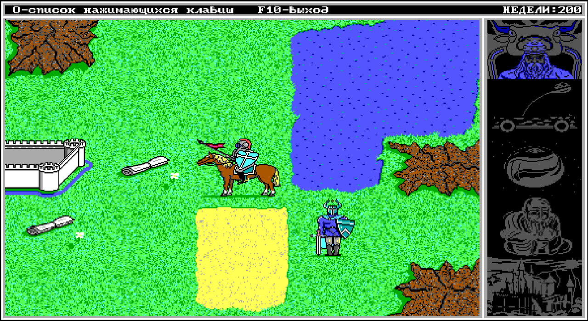

# King's Bounty 2 — continued



Продолжение DOS-игры на Turbo Pascal 7.0. Ветка `continued` предназначена для рефакторинга, исправления ошибок, развития баланса и нового контента. Историческая реконструкция сохранена в ветке [`main`](https://github.com/pavel-voronin/kb2-restored/tree/main).

Сборка остаётся DOS-приложением; будущая веб-версия будет запускать тот же EXE через эмулятор. Структурный рефакторинг завершён; игровые правила пока сохранены. Классический и исправленный режимы, исправления правил и веб-запуск ещё впереди. [Требования, устройство кода и список багов](DEVELOP.md).

Оригинальную игру разработал **Сергей Прокофьев**.

## Собрать и запустить

Скопируйте папку проекта в DOS и выполните из её корня:

```dos
BUILD
RUN
```

Готовая игра появляется в `SRC/DIST/`.

На современном компьютере откройте DOSBox и подключите папку проекта как диск:

```dos
MOUNT C C:\GAMES\KB2
C:
BUILD
RUN
```

Замените `C:\GAMES\KB2` на путь к своей копии проекта.

Для запуска с ограничениями старого компьютера используйте DOSBox-X из корня проекта: `dosbox-x -conf DOSBOX/LOW.CNF` или `dosbox-x -conf DOSBOX/PLAY.CNF`. Сначала соберите игру обычной командой `BUILD`. Параметры профилей и ограничения измерений описаны в [DEVELOP.md](DEVELOP.md#ограничения-dos).

## Детали

Начните с `SRC/KB2.PAS` и `SRC/KBAPP.PAS`; [карта модулей](DEVELOP.md#текущая-архитектура) описывает разделение ответственности. Проверки генерации и сохранений запускаются командой `TEST` из корня после `BUILD`. Они работают в DOS и не требуют оригинального EXE. [Стенд сравнения скорости, памяти и объёма работы](BENCH/README.md) собирает референс из исходников и сравнивает его с continued.

PCX-экраны имеют размер **640×350**. Атласы состоят из кадров **96×60**, по четыре в строке; `FONT.PCX` содержит 240 знаков **8×8**. При редактировании сохраняйте размеры, 16-цветную палитру EGA и четыре битовые плоскости PCX.

Тексты и Pascal-исходники сохраняйте в **CP866 с CRLF**; имена файлов соответствуют **DOS 8.3**.

Состояние разделено на `Game.Campaign`, `Game.Runtime` и `Game.World`; физический порядок полей сохраняет совместимость со старыми сохранениями и ассемблерными процедурами. Кандидаты на ошибки собираются отдельно в [BUGS.md](BUGS.md).

Оригинальные файлы игры взяты из [Internet Archive](https://archive.org/details/msdos_Kings_Bounty_2_1993).

## Лицензия

Автор оригинальной игры — Сергей Прокофьев. Реконструкция исходного кода выполнена Павлом Ворониным.

В той мере, в какой мне принадлежат права на результаты реконструкции и дополнения проекта, я предоставляю их по [лицензии MIT](LICENSE). Права на оригинальную игру и сторонние компоненты сохраняются за их правообладателями.
